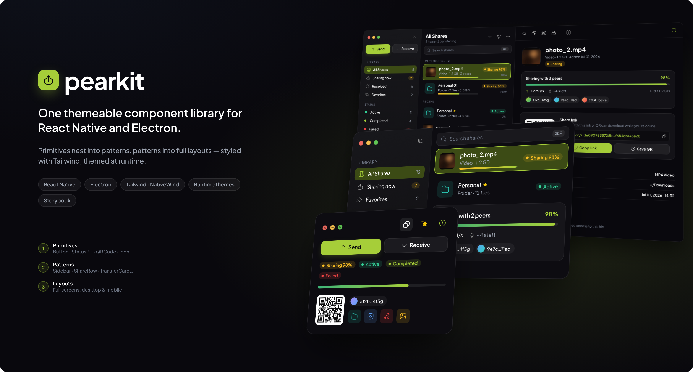

<p align="center">
  
</p>

<h1 align="center">pearkit</h1>

<p align="center">
  <b>One themeable component library for React Native and Electron.</b><br/>
  Styled with Tailwind (NativeWind), themed at runtime, documented in Storybook.<br/>
  The UI kit behind <a href="https://peardrive.com">PearDrive</a> apps such as PearDrop.
</p>

<p align="center">
  <a href="#quick-start">Quick start</a> ·
  <a href="docs/theming.md">Theming</a> ·
  <a href="docs/electron.md">Electron</a> ·
  <a href="docs/react-native.md">React Native</a> ·
  <a href="docs/components.md">Components</a> ·
  <a href="#storybook">Storybook</a>
</p>

---

## Why pearkit

- **Write once, ship on both.** Components are built from React Native primitives (`View`, `Text`, `Pressable`, `react-native-svg`). They run natively on iOS/Android and render to the DOM in Electron through `react-native-web`, with no platform forks in your app code.
- **Tailwind all the way down.** Everything is styled with `className` via NativeWind. Every component accepts `className`, and your classes win (`tailwind-merge`).
- **Runtime themes.** A theme is a plain object. `ThemeProvider` turns it into CSS variables that the Tailwind preset reads, so `bg-primary` follows the active theme. You can switch, nest or derive themes without rebuilding.
- **Configurable.** Tone props take theme tokens, icons accept a name or any element, labels and actions can be overridden, and components work controlled or uncontrolled.
- **Desktop-grade details.** In-app macOS window controls wired to Electron, a sidebar you can resize with the mouse and collapse to an icon rail, tooltips with shortcuts, and drag regions for frameless windows.

## Quick start

```bash
npm install github:peardrive/pearkit
npm install nativewind@^4.1 tailwindcss@^3.4 react-native-svg
```

```js
// tailwind.config.js
module.exports = {
  content: ['./src/**/*.{ts,tsx}', './node_modules/pearkit/src/**/*.{ts,tsx}'],
  presets: [require('nativewind/preset'), require('pearkit/tailwind-preset')],
};
```

```tsx
import 'pearkit/global.css';
import { ThemeProvider, ShareRow, Button } from 'pearkit';

export default function App() {
  return (
    <ThemeProvider theme="dark">
      <ShareRow
        name="photo_2.mp4"
        meta={['Video', '1.2 GB', '3 peers']}
        thumbnail={{ kind: 'video' }}
        status="sharing"
        progress={0.98}
        timestamp="now"
        selected
      />
      <Button variant="primary" glow icon="arrow-up" label="Send" />
    </ThemeProvider>
  );
}
```

Then follow the guide for your platform:

| Platform | Setup |
| --- | --- |
| **Electron** | `pearkit()` Vite plugin + `pearkit/electron` bridge for the window controls → [docs/electron.md](docs/electron.md) |
| **React Native** | NativeWind Babel/Metro config + Plus Jakarta Sans fonts → [docs/react-native.md](docs/react-native.md) |

## What's in the box

| Layer | Components |
| --- | --- |
| **Foundations** | `ThemeProvider` · `createTheme` · `Text` (9-step type scale) · `Icon` (37 icons, 22 exported from the Figma file) · `LinearGradient` / `RadialGlow` |
| **Components** | `Button` · `IconButton` · `Tooltip` · `StatusPill` · `StatusDot` · `CountBadge` · `ProgressBar` · `SearchField` · `Thumbnail` · `Avatar` · `PeerChip` · `QRCode` · `LinkField` · `KeyValueList` · `EmptyState` · `TextField` · `Dialog` · `Card` · `Divider` · `Kbd` · `SectionLabel` · `Spacer` |
| **App chrome** | `WindowControls` · `DragRegion` · `Sidebar` (resizable, collapsible) · `Toolbar` · `PaneHeader` · `AppWindow` / `Pane` / `PaneBody` |
| **PearDrop patterns** | `ShareRow` · `FileHeader` · `TransferCard` · `ShareLinkCard` · `NetworkStatusCard` · `DangerZone` |
| **Layouts** | Full desktop and mobile PearDrop screens, built only from the components above |

Full API: [docs/components.md](docs/components.md).

## Theming in 20 seconds

```tsx
import { ThemeProvider, createTheme, darkTheme } from 'pearkit';

const blueberry = createTheme(darkTheme, {
  name: 'blueberry',
  colors: { primary: '#7aa2ff', 'primary-strong': '#8b5cf6', selected: '#1f2a4d' },
});

<ThemeProvider theme={blueberry}>…</ThemeProvider>   // or "dark" | "light" | "system"
```

There are 32 colour tokens (surfaces, text, brand, status, window chrome). In Tailwind they're written `bg-primary`, `text-muted`, `border-overlay/[0.08]`; in JS, `useTheme().colors.primary`. See [docs/theming.md](docs/theming.md).

## Resizable sidebar

```tsx
<Sidebar resizable defaultWidth={236} minWidth={200} maxWidth={380} onResizeEnd={saveWidth}>
  <SidebarHeader>
    <WindowControls />          {/* macOS traffic lights, wired to Electron */}
    <SidebarSpacer />
    <SidebarToggle />           {/* collapse to an icon rail */}
  </SidebarHeader>
  <SidebarSection title="Library">
    <SidebarItem icon="grid-1" label="All Shares" count={12} selected />
    <SidebarItem icon="export" label="Sharing now" badge={{ value: 2, tone: 'warning' }} />
  </SidebarSection>
</Sidebar>
```

You can drag the edge with a mouse, touch or pen, double-click it to reset, or focus it and use ←/→. Dragging past the minimum collapses the sidebar.

## Storybook

```bash
npm install
npm run storybook        # http://localhost:6006
```

- **Every component** has a story with a `Playground` (live controls) and its real variants.
- **Foundations** show the colour tokens, type scale, icon gallery and themes side by side.
- **Layouts** show the full PearDrop desktop screen (interactive: filter, search, select, resize, collapse) and the mobile screens. They're made only from library components, so a broken component shows up in them straight away.
- The **Theme** switcher in the toolbar re-renders any story in Pear Dark, Pear Light or a custom theme.
- **Docs** pages render the guides in this repo.

## Project structure

```
src/
  theme/        tokens · themes · createTheme · ThemeProvider
  icons/        generated icon registry · <Icon/>
  components/   one folder per component (Component.tsx + Component.stories.tsx)
  electron/     window bridge (pearkit/electron)
  stories/      docs, foundations, layouts, fixtures
icons/          SVG sources → `npm run icons`
docs/           guides (also shown in Storybook)
examples/       electron/ · react-native/
tailwind.preset.js · global.css · vite.js
```

## Scripts

| Command | |
| --- | --- |
| `npm run storybook` | Develop components in isolation |
| `npm run build-storybook` | Static Storybook in `storybook-static/` |
| `npm run typecheck` | TypeScript |
| `npm run prepare` | Build `lib/` (CommonJS, ESM, types) with react-native-builder-bob |
| `npm run icons` | Regenerate the icon registry from `icons/**/*.svg` |
| `npm run readme:header` | Re-render this README's header image from its story |

## Contributing

PRs are welcome. PearDrive is open source and non-commercial. Read [docs/contributing.md](docs/contributing.md) for the conventions: RN primitives only, colour only through tokens, full Tailwind class names, a story for every component.

## License

ISC
